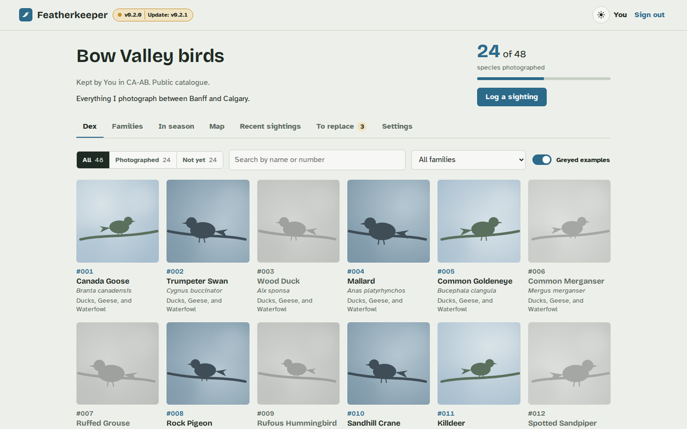
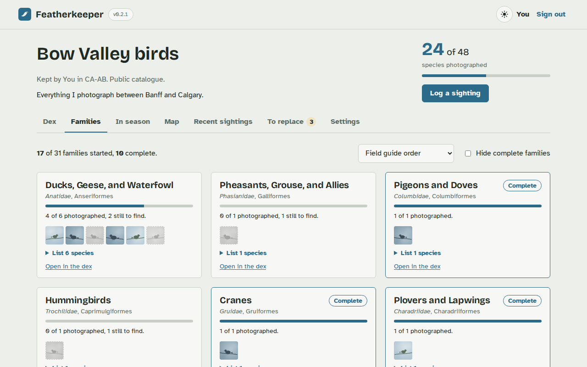
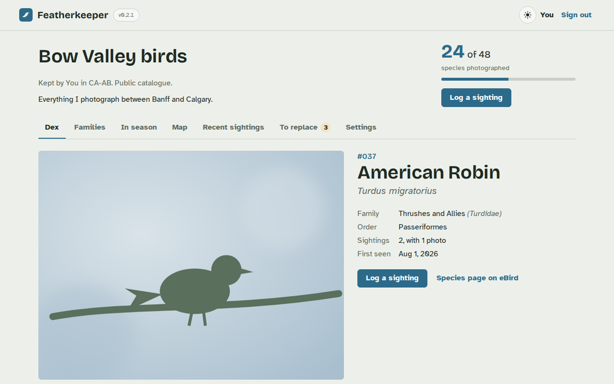
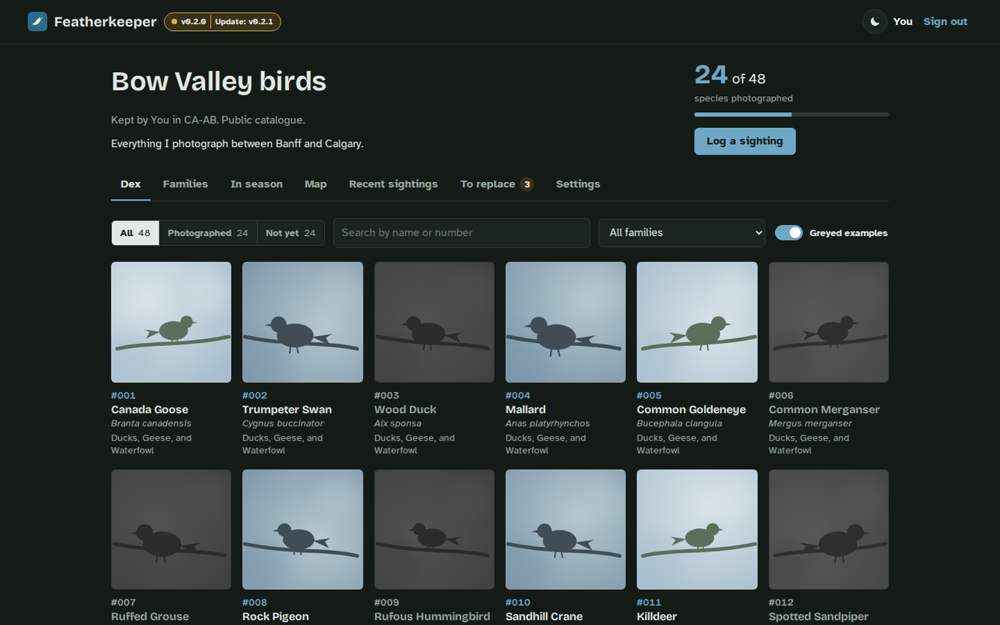
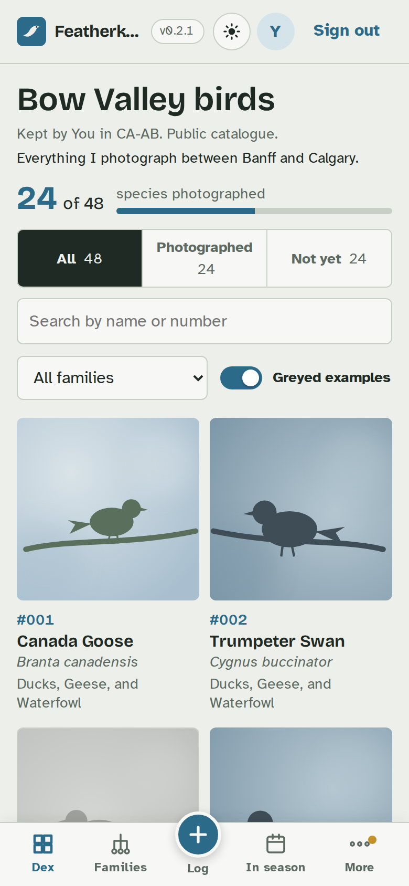

# Featherkeeper

**A self-hosted birding log that works like a pokédex.** Build a checklist of the birds that live
around you, log every sighting, keep an album of your photos for each species, and see at a glance
which birds you've photographed and which you're still looking for.

You run Featherkeeper on your own server, the way you'd run Immich or Jellyfin: a Proxmox LXC, a
Raspberry Pi, a NAS or any Linux machine with Docker. Your photos and records stay with you.

[Install it](install.md){ .md-button .md-button--primary }
[Try the demo](https://tposella.github.io/featherkeeper/){ .md-button }

!!! note "Early releases (0.x)"
    Featherkeeper is usable day to day, but it's new: expect rough edges and changes between
    releases, read the [upgrade notes](updating.md#upgrade-notes) before you update, and **keep
    backups**. Found a bug or have an idea?
    [Open an issue](https://github.com/tposella/featherkeeper/issues/new/choose).

## No telemetry

Featherkeeper doesn't phone home. There are no analytics, no usage statistics, no crash reports and
no accounts with us: nothing about you, your site or your birds is sent to the project. The only
outside requests are lookups to public birding and mapping databases, and a check for new releases on
GitHub, and each one can be switched off. The full list is on the [privacy page](privacy.md).

## Features

**Catalogues and sharing**

- Several catalogues per site (your backyard, a local park, a whole province), each with an **owner**
  and any number of **editors**.
- Per-catalogue visibility: **Private** (owner and editors), **Signed-in users**, or **Public**.
- Option to **hide exact locations** from viewers, for nest sites, sensitive species or your home.
  Hidden locations also hide original photo files, because those carry GPS.

**Building the species list**

- **Import from eBird** around a town or place (search it or click the map, choose 5 to 50 km), or for
  a whole region by its eBird code (e.g. `CA-AB`).
- Preview the list with checkboxes before anything is saved. Add species by hand at any time.

**The dex**

- A grid in field-guide (taxonomic) order with plate numbers (#001, #002...).
- Species you haven't photographed show as **greyed example photos**, replaced by your own photo in
  full colour once you add one, or as **empty slots** if you prefer.
- Filter by **Photographed / Not yet**, search by name or number, and filter by family.
- **Families** view: progress per bird family, sortable by "most left to photograph" or "closest to
  complete".
- **In season** view: birds reported nearby in the last 30 days and birds usually photographed there in
  any month, with rarities missing from your catalogue listed separately.
- **Only this time of year:** In season marks each bird as only around now, seasonal or year-round, and
  a switch shows just the seasonal ones, so you can go after the birds you won't see again until next
  year.

**Species pages**

- Your **album** of every photo of that bird, with a chosen **thumbnail**.
- Mark a photo as **want to replace** with a note ("backlit", "only the tail"), and find them all on
  the **To replace** tab.
- **When and where to find it:** month-of-year and time-of-day charts from nearby observations,
  habitat from Wikipedia, and recent eBird reports.
- **Calls and songs:** openly licensed recordings, nearest to your area first.

**Logging sightings**

- Add photos (JPEG, HEIC from iPhones, PNG, WebP, TIFF or AVIF). **Date, time, GPS and camera** are
  read from each photo, and the place name is filled in from the nearest eBird hotspot.
- **Bulk upload** a whole shoot, and get **duplicate warnings** for photos already in the catalogue.
- **AI identification (optional, runs on your server):** the top 3 matches with confidence, weighted
  by what eBird has recorded where the photo was taken. See [AI identification](ai-identification.md).

**Running it**

- Ready-made Docker images for x86-64 and ARM, a [one-line installer](install.md), and update alerts
  for the site admin.
- **Export** any catalogue as a ZIP (CSV spreadsheets plus original photos), a backup script, and
  password resets in the app or from the server console.
- Works on phones, with light and dark mode.

{ width="260" }

